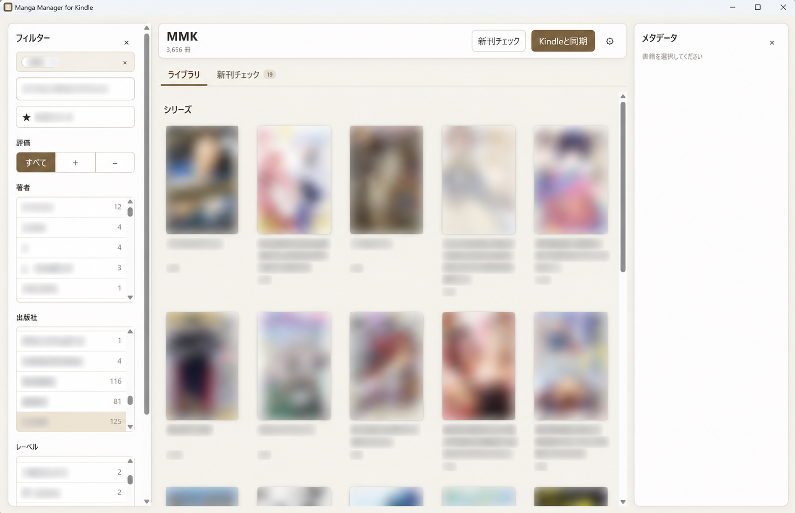

# Manga Manager for Kindle (MMK)



Windows 版 Kindle のローカルメタデータを読み取り、自分用のタグ、評価スコア、お気に入り、シリーズを管理するデスクトップアプリです。Kindle 側へは書き込まず、読書時は Amazon 公式 Web Reader を既定ブラウザで開きます。

主な機能:

- Kindle ライブラリの同期（公式Kindleアプリのメタデータを参照）
- タイトル・著者・タグ・ASIN の検索
- お気に入り、正負の評価スコア、タグ
- タイトルからのシリーズ推定とシリーズ単位の棚表示
- メタデータ（タイトル、著者、出版社、シリーズ名、巻数）は手動で管理可能
- ログインするとシリーズの新刊情報を取得可能（Amazon の「読み始めたシリーズの続きを読むにはこちら」がソース）、ストアページを開くリンク付き
- 正規Kindle Cloud Readerに表示された書籍のスクリーンショットからCBZバックアップを生成（Windows）
- 未バックアップの書籍を順番に処理する一括バックアップ

> [!tip]
> 新刊チェック機能・バックアップ用の内蔵リーダーを使う場合は、内蔵ブラウザでAmazonにログインする必要があり、そのログイン状態（Cookie等）は用途別の専用ブラウザ領域に保持します。MMKの処理がID/メールアドレスやパスワードを取得・DBに保存することはありません。外部ブラウザのCookieは読み取りません。

## 動作環境

- Windows 11以降
- Microsoft Edge WebView2 Runtime（Windows 11 には標準で同梱）
- Kindle 公式アプリが導入され、ログイン済みであること

## 利用方法

ReleasesからダウンロードしたZIPを展開し、mmk.exeを実行、「Kindleと同期」ボタンを押してください。

公式アプリが古い場合や設定を変えている場合、同期に失敗することがあります。その場合は歯車アイコンから設定ペインを開き、`KindleSyncMetadataCache.xml`の場所を設定してください。

## 開発環境

- Windows 11
- Node.js 22.5 以降
- pnpm 11 以降
- Rust 1.77.2 以降
- Microsoft C++ Build Tools

ビルド済み exe を実行するだけの場合、Node.js、pnpm、Rust、Microsoft C++ Build Tools は不要です。Windows の WebView2 Runtime は必要です。Windows 11 には通常インストール済みですが、起動できない場合は Microsoft Edge WebView2 Runtime を導入してください。

## セットアップと起動

```powershell
pnpm install
pnpm tauri dev
```

初回起動後に「Kindleと同期」を押すと、`%LOCALAPPDATA%\Packages` から Kindle パッケージを検出します。Kindle のプロファイルを別の場所へ移している場合は、設定画面の「Kindleプロフィール」に `KindleSyncMetadataCache.xml` を含むフォルダー、または XML ファイルのフルパスを指定できます。MMK の DB は Tauri の app data directory に `mmk.sqlite3` として保存されます。

「新刊チェック」はAmazonのページをアプリ専用WebViewで開きます。ログイン状態はそのWebViewの専用データ領域にのみ保存し、Chrome等のCookieを読み取ったり、Cookie文字列をMMKのDBへ保存したりしません。「Amazon連携を解除」を押すと、専用WebViewの閲覧データと取得済み候補を削除します。

### CBZバックアップ

この機能は、正規のKindle Cloud Readerに表示された書籍のスクリーンショットからCBZファイルを生成する、私的複製の範囲でのバックアップ用機能です。利用権限のある書籍だけを対象とし、第三者への配布・公開・共有には使用しないでください。コンテンツ保護の回避は行いません。この説明は個々の複製行為の適法性を保証するものではありません。

1. 初回は歯車の設定画面で保存先、読み込み・描画完了の自動検知、縦長表示を確認します。設定は変更すると自動保存され、次のバックアップから適用します。
2. 書籍詳細の「バックアップ…」、またはライブラリの「一括バックアップ…」を押します。警告ダイアログを確認すると詳細画面に進みます。
3. 対象の書籍一覧を確認し、「バックアップ開始」を押します。リーダーは自動で開きます。初回はその画面でAmazonにログインしてください。一括では現在の一覧に含まれる未バックアップの有効な書籍を抽出し、シリーズ・巻数・書籍名順に処理します。絞り込みがなければ全書籍（シリーズカード内の全巻を含む）、検索や各種フィルターを使っていればその結果、シリーズを開いていればそのシリーズ内の表示対象だけです。完成済みの本は開始時にも再確認してスキップします。

詳細画面は書籍一覧、開始・停止ボタン、進捗表示だけです。設定は単巻と一括で共通で、変更は次の開始から適用します。保存先が空欄の場合はOSの「ピクチャ」内の `MMK` がルートです。従来の保存先設定は引き継ぎます。旧版の動作設定ではなく、新しい `backup-settings.json` を使用します。ファイルの実際の場所は設定画面に表示されます。自動検知は既定で有効で、以前のJSONに `autoWait` がない場合も有効として読み込みます。

```json
{
  "pageLayout": "single",
  "waitTimeoutMs": 30000,
  "maxPages": 1000,
  "key": "left"
}
```

`pageLayout` は `single`（単ページ）または `spread`（見開き）で、設定画面の「単ページ／見開き」と共通です。単ページではリーダーウィンドウを縦長に調整します。見開きでは左右2ページを1枚の画像として保存します。

自動検知では、ページの表示更新、表示画像の読み込みと `decode()` 完了、ページ送りアニメーション終了、2回の描画フレームを確認でき次第スクリーンショットを保存します。画像の保存完了後に次のページを送るため、ページごとの固定秒数は待ちません。状態確認は約16ms間隔で行い、旧ページの画像や読み込み途中の画像は保存しません。表示画像の識別情報はリーダー内でのみ比較し、画像URLの取得・ダウンロードや本文の内部APIは使いません。取得した画像の後処理による高速化ではありません。

`waitTimeoutMs`（1000〜120000ms、既定30000ms）は自動待機の上限で、毎ページ待つ時間ではありません。画像更新や次の位置を確認できなければ中断し、CBZを確定しません。

1冊の保存上限 `maxPages`（1〜10000枚、既定1000枚）は異常時の安全策で、設定ファイルだけで変更します。最終位置に届かず上限に達した場合はCBZを確定しません。ページ送りキー `key`（`left` / `right` / `pagedown` / `space`）も設定ファイルだけで変更します。設定ファイルの変更は次回の設定読み込み・バックアップ開始時に反映され、UIの自動保存ではこれらの値を変更しません。

保存先は `ルート\シリーズ名\書籍名.cbz` です。シリーズ未設定は `シリーズなし` にまとめます。CBZは通常のZIPで、中身は `screenshot_00001.png` からの5桁の連番画像です。Windowsで使えない文字・予約名・長すぎる名前は安全な名前と短いハッシュに変換します。同名の別ASINや不明な既存ファイルと衝突した場合は `書籍名 [ASIN].cbz` に分け、既存ファイルを上書きしません。

バックアップ済みの判定には、MMKが完成させたCBZの識別情報（ZIPコメント内のASIN・枚数）と連番エントリーを使います。旧版の画像フォルダーや途中停止した画像だけでは完成扱いにしません。従来の画像を自動変換・移動・削除することはありません。タイトル・シリーズ名や保存先を変えた場合、以前のCBZは移動せず、新しい保存パスで判定します。

各冊は内蔵リーダーの `https://read.amazon.co.jp/?asin=ASIN` で開き、本文の読み込みを最大90秒待ちます。通常の「Kindleで読む」の設定は変えません。目次の最上位項目へ移動し、画像の読み込み・描画完了を待ってから、その位置を開始点として記録します。開始位置は1に限定せず、位置2などから始まる書籍にも対応します。開始確認のための反復逆送りや往復のページ送りは行いません。記録した開始位置と保存開始時の位置・総数が一致する場合だけ保存を始めます。目次への移動・描画完了・位置取得を確認できない場合は停止します。Kindleの読書位置に影響する場合があり、元の位置は自動復元しません。

終了判定は、リーダーの通常の画面にある「位置1/196」等の現在位置・総数を使います。先頭から1位置ずつ進んで最終位置を保存したときだけ、CBZを確定して次の本へ進みます。同じ絵でも位置が異なれば保存します。同じ位置では重複保存せず、描画待ちを繰り返します。位置の取得不能・総数変更・逆行・飛び越し・ページ送りの停止、保存上限、その他のエラーでは全体を止め、未完了のCBZは生成しません。位置がページと1対1でない書籍には対応しません。画像の変化や丸められた100%表示を完了の根拠にはしません。

ヘッダーとフッターの位置表示を確認し、現在位置だけの表示より現在位置・総数の組を優先します。操作バーを閉じると位置表示が消える場合は、各ページの画像取得前に一度だけ操作バーを開いて読み取り、閉じたことを確認してから画像を取得します。取得後は操作バーを開かず、本文の表示状態と取得可能な位置表示だけを確認します。確認済みの現在位置と総数を使って最終ページを判定し、画像の保存が済むまでページ送りは行いません。読み取れない場合は、確認できた位置表示の文字列も停止メッセージに表示します。

ページ送りは保存後に実際のキー入力を一度だけ送ります。リーダーの入力面への強制フォーカスや `tabindex` の追加は行いません。

操作バーの表示判定には、常設のヘッダー枠ではなく実際の操作ボタンの表示状態を使います。IonicのShadow DOM内のボタンと親要素による切り抜きも確認し、空のヘッダー枠や隠れたボタンを表示中とは判定しません。目次を閉じる際は、閉じるボタンが画面外に出ても、クリックを遮る背景幕が残る間は待機します。目次への移動中に一時的にcanvasだけが見えた場合は、設定済みの描画待機上限まで画像の表示を待ちます。canvasの画像内容は読み取らず、上限まで画像へ切り替わらなければ停止します。

処理中の画像は `ルート\.mmk-backup\ASIN\実行ID` に保存し、完成CBZの確定後にその実行で生成した画像だけを削除します。途中停止した画像は残し、再試行は別の実行フォルダーで先頭からやり直します。CBZ生成に失敗しても元画像は残ります。

ページ領域は表示要素の位置・寸法と背景境界から自動判定し、本来の白い原稿余白を残します。背景色は自動変更せず、緑色に固定した判定もしません。色付きのページ背景が画像要素内に含まれる場合は、安全に確認できる背景部分だけを補正します。見開き・判定不能では停止します。内部の書籍データや保護APIは利用しません。「前回読んでいたページ」の確認に限って「いいえ」を選び、他の確認画面は自動操作しません。別ASINへの遷移も拒否します。

縦長調整では、ウィンドウの高さをディスプレイの作業領域いっぱいにし、クライアント領域の幅を高さの約0.90倍にします。正規リーダーが左右に確保するページ送り領域（合計約2割）の分だけ、従来の約0.68倍から横幅を広げています。これにより一般的な漫画のページは横幅に制限されず、高さいっぱいに再描画されます。リーダーのCSSや画像要素は変更せず、保存済み画像の引き伸ばしもしません。画面の横幅が足りない場合やページの縦横比によっては上下余白が残ります。Windowsのタイトルバーやタスクバーの領域は使いません。

実行中はリーダーを前面に保ち、他の画面で覆わず、マウスやキーボードを操作しないでください。フォーカス変更・最小化・終了・サイズ変更・Escでも停止します。自動スリープ・画面消灯を抑止しますが、画面ロックやスクリーンセーバーは防ぎません。詳細画面を閉じるだけでは停止しません。

内蔵リーダーのログイン領域は新刊チェック用とは独立しています。設定の「バックアップ用リーダーのAmazon連携を解除」で閲覧データを削除できます。Amazon日本のHTTPSページ以外には遷移を許可せず、読書ページにMMKの操作権限は与えません。

### バックアップ操作ログ

バックアップ開始時に、アプリのデータフォルダー内 `logs\backup\backup-<実行ID>.jsonl` へ操作ログを作成します。Windowsの既定位置は `%APPDATA%\com.ymkn.mmk\logs\backup` です。実際のファイルパスはバックアップ詳細画面にも表示します。

- 時刻・実行ID・連番・経過時間、単ページ／見開き、キー、待機上限、ウィンドウ寸法
- 目次への移動、先頭位置の確認、位置・総数、操作バーの表示状態（ボタン数・表示中のボタン数・ヘッダー枠の表示有無を含む）
- `key_send_requested`（送信要求）と `key_send_accepted`（Windowsでの受付）。受付は実際のページ移動を保証しません。後続の位置記録と合わせて確認します。
- 描画待機の開始・完了・タイムアウト、画像読込・デコード・描画・アニメーション等の待機理由、画像更新番号（token）、更新待ちかどうか
- 保存枚数、保存領域、CBZの確定、停止・エラーの段階と分類コード

本文・画像・画像URL・Cookie・ログイン情報・書籍名・保存先パスはログへ出力しません。書籍は処理順とASINのハッシュで区別します。エラー文には書籍名やパスが含まれる場合があるため、その全文は記録せず分類コードを残します（元のメッセージは従来の画面に表示します）。ログは外部送信しません。

直近10実行を保持します。各実行は2MiBでローテーションし、現在と直前の2ファイル（最大約4MiB／実行）だけを残します。描画待機の反復は状態変化時と約2秒ごとの記録に抑えます。書き込みに失敗してもバックアップは止めず、画面にログ保存エラーを表示します。

Release 実行ファイルの生成:

```powershell
pnpm build:exe
```

出力は `src-tauri\target\release\mmk.exe` です。
この exe はフロントエンド資産と SQLite を内包しているため、`dist` や Node.js を同じ場所へ置かずに起動できます。Tauri の Windows 実行基盤である WebView2 Runtime だけは OS 側の依存関係として残ります。

## テスト

```powershell
pnpm build
cargo test --manifest-path src-tauri\Cargo.toml
node --test src-tauri\tests\reader-layout.test.mjs src-tauri\tests\reader-first-page.test.mjs src-tauri\tests\reader-resume.test.mjs src-tauri\tests\reader-navigation.test.mjs src-tauri\tests\reader-ready.test.mjs
node --test tests\capture-settings.test.mjs
node --test tests\command-acl.test.mjs
node --test tests\backup-scope.test.mjs
node --test src-tauri\tests\reader-page-render.test.mjs
node --test src-tauri\tests\reader-input-regression.test.mjs
```

実ユーザーの Kindle キャッシュを読み取り専用で parser に通す確認:

```powershell
cargo test --manifest-path src-tauri\Cargo.toml live_kindle_cache_parses_without_personal_output -- --ignored
```

設計文書は [docs/README.md](docs/README.md) から参照できます。

## 免責

本ソフトウェアは Amazon によって作成・承認・後援されたものではありません。Amazon、Kindle および関連するロゴ・名称は、それぞれの権利者に帰属します。
